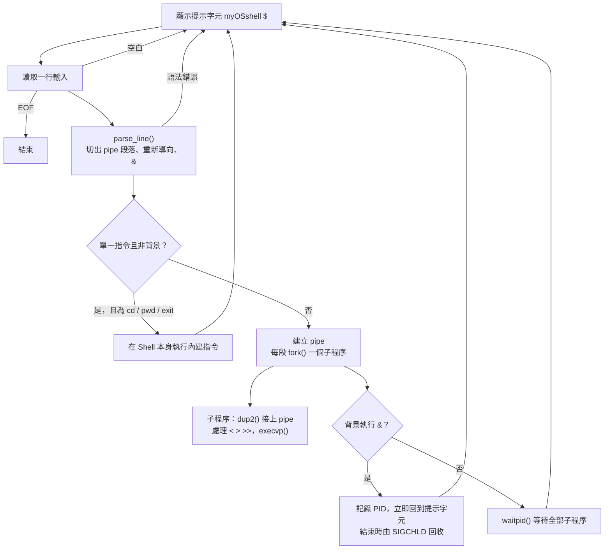

# 🐚 myOSshell — 用 C 實作的微型 Linux Shell

作業系統課程專題。以 C 語言從零實作一個 Linux Shell：自己解析指令，透過 `fork()` / `execvp()` / `waitpid()` 建立與管理子處理程序，並支援背景執行（`&`）、多重管線（`|`）與輸入／輸出重新導向（`<`、`>`、`>>`），呈現作業系統中 process 管理與 file descriptor 操作的核心概念。


---

## ✨ 支援功能

- **處理程序管理**：`fork()` / `execvp()` / `waitpid()` 建立並等待子處理程序
- **背景執行** `&`：顯示背景 process 的 PID；用 `SIGCHLD` + `waitpid(WNOHANG)` 回收已結束的背景 process，避免 zombie
- **管線** `|`：支援多重 pipe，例如 `ps aux | grep root | more`（最多串接 8 個指令）
- **重新導向**：輸入 `<`、輸出覆蓋 `>`、輸出追加 `>>`
- **內建指令**：`cd`（`chdir()`）、`pwd`（`getcwd()`）、`exit`
- **錯誤處理**：空白輸入、不存在的指令、`cd` 到不存在的目錄、pipe／重新導向語法錯誤，以及 `fork()`、`execvp()`、`pipe()`、`open()` 失敗時，都會顯示錯誤訊息並回到提示字元，不會讓 Shell 崩潰

### 指定測試指令（16 項）

```
ps, ps axjf, ps aux, ls -l, ls -l | more, top, cal, whoami,
date, pwd, mv, cp, file, cat, rm, vi
```

以上指令都是 Shell 自己 `fork()` + `execvp()` 執行外部程式，不是寫死的輸出。另外也支援 `mkdir`、`rmdir`、`echo`、`clear`、`grep`、`more`。

---

## 🔄 執行流程



---

## 🚀 編譯與執行

**環境**：Ubuntu Linux（建議 Ubuntu 22.04 或 WSL2 + Ubuntu）、GCC

```bash
make            # 或：gcc myshell.c parser.c executor.c -o myOSshell
./myOSshell
```

```text
myOSshell $ ls -l | more
myOSshell $ sleep 10 &
myOSshell $ echo hello > out.txt
myOSshell $ cat < out.txt
```

完整測試步驟見 [test_cases.md](test_cases.md)。

---

## 📁 程式架構

```text
myshell.h    共用資料結構（Command、ParsedLine）與函式宣告
myshell.c    main() 主迴圈、提示字元、讀取輸入、SIGCHLD 處理
parser.c     指令字串解析（pipe / redirection / background）
executor.c   內建指令、fork / execvp / waitpid、管線與重新導向執行
Makefile     編譯設定
```

---

## 🖼️ 測試截圖

截圖都在 [`screenshots/`](screenshots/)：

| 截圖 | 內容 |
|---|---|
| [基本指令 ls ls -l](<screenshots/基本指令 ls ls -l.png>) | `ls`、`ls -l` |
| [基本指令 ps ps aux](<screenshots/基本指令 ps  ps aux.png>) | `ps`、`ps aux` |
| [基本指令 ps axjf](<screenshots/基本指令ps axjf.png>) | `ps axjf` |
| [ls -l more cal whoami date pwd](<screenshots/ls -l more cal whoami date pwd.png>) | `ls -l \| more`、`cal`、`whoami`、`date`、`pwd` |
| [pipe 測試](<screenshots/pipe測試.png>) | 單一與多重管線 |
| [背景執行測試](<screenshots/sleep 10 & ps 背景測試.png>) | `sleep 10 &` 與背景 PID |
| [重新導向測試](<screenshots/Redirection 測試.png>)、[測試 2](<screenshots/Redirection 測試2.png>) | `>`、`>>`、`<` |
| [檔案操作](<screenshots/mv cp file copy cat copy rm copy.png>) | `mv`、`cp`、`file`、`cat`、`rm` |
| [其他指令](<screenshots/mkdir rmdir echo grep main.png>) | `mkdir`、`rmdir`、`echo`、`grep` |
| [內建指令測試](<screenshots/內建指令測試.png>) | `cd`、`pwd`、`exit` |
| [top](<screenshots/top.png>)、[vi](<screenshots/vi.png>) | 全螢幕互動式程式 |
| [錯誤測試](<screenshots/錯誤測試.png>) | 各類錯誤輸入處理 |

完整說明見 [微型作業系統實作報告.pdf](微型作業系統實作報告.pdf)。

---

## ⚠️ 已知限制

1. `top`、`vi` 是全螢幕互動式程式：`top` 按 `q` 離開，`vi` 輸入 `:q` 或 `:wq` 離開，之後會回到 `myOSshell $` 提示字元。
2. 尚未實作指令歷史（history）、Tab 自動補全、別名（alias）等進階功能。
3. 管線最多串接 `MAX_COMMANDS`（8）個指令。
4. 依賴 UNIX 系統呼叫（`fork`、`execvp`、`pipe`、`waitpid` 等），只能在 Linux／UNIX 類環境（含 WSL2 + Ubuntu）編譯執行，無法在 Windows 原生環境執行。
